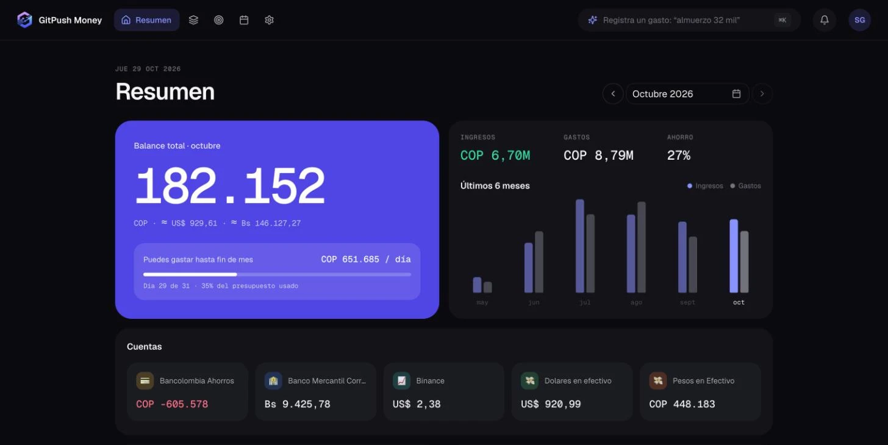

<!-- markdownlint-disable-next-line MD041 -->
<a id="top"></a>

<div align="center">



<h1>GitPush Money</h1>

<p><strong>Personal finance with an AI copilot — multi-currency, multi-account, mobile-first.</strong></p>

<p>
<a href="https://github.com/Sanghel/expense-manager/releases"></a>
<a href="https://expense-manager-pied-three.vercel.app"></a>


<a href="LICENSE"></a>
</p>

<p>
<a href="https://expense-manager-pied-three.vercel.app"><strong>Live demo</strong></a> &bull;
<a href="#features"><strong>Features</strong></a> &bull;
<a href="#quick-start"><strong>Quick start</strong></a> &bull;
<a href="CHANGELOG.md"><strong>Changelog</strong></a>
</p>

<br/>

<p>
Tracking money across banks, currencies and apps usually means a spreadsheet you stop updating by March.
<strong>GitPush Money reads your bank emails, lets you log spending in plain language, and has an AI coach
that tells you where the money actually went.</strong>
</p>

<br/>



<br/><br/>

<sub><strong>BUILT WITH</strong></sub>

<br/>


<br/><br/>

</div>

<div align="center"></div>

## Features

<table>
<tr>
<td width="50%" valign="top">

### 🤖 AI copilot
Log expenses in plain language (*"paid 10,000 pesos for a cake"*) and confirm before saving. A savings coach
diagnoses the month, suggests budgets and savings goals, and spots small recurring leaks — powered by Claude.

</td>
<td width="50%" valign="top">

### 📬 Bank email sync
Connects to Gmail (read-only) and turns bank notifications into transactions. Parsers for Bancolombia,
Mercantil, Binance and Bank of America; low-confidence matches wait in a review queue.

</td>
</tr>
<tr>
<td valign="top">

### 💱 Multi-currency & accounts
COP, USD and VES with daily exchange rates. Every account keeps its own currency and balance, and the
dashboard converts everything to your preferred one.

</td>
<td valign="top">

### 📊 Dashboard & analysis
"Pulso" design in dark and light: balance hero with a daily spending allowance, and seven analysis
cards (spending pace with projection, savings rate, month-over-month changes, small recurring
expenses, fixed vs. variable, currency exposure, weekdays), each ending in a plain-language takeaway.

</td>
</tr>
<tr>
<td valign="top">

### 🎯 Budgets & savings goals
Budgets per category or overall, as a fixed amount or a percentage of income; a category group's
budget is the sum of its categories'. Goals
track contributions, pace and deadline status.

</td>
<td valign="top">

### 🔁 Recurring, reminders & loans
Recurring payments, reminders for income and expenses with a notification bell, a calendar view, and a
debts & loans tracker.

</td>
</tr>
<tr>
<td valign="top">

### 📥 Import & export
Import `.xlsx` / `.csv` statements through a 3-step wizard with per-row validation. Export to CSV or JSON
with custom filters.

</td>
<td valign="top">

### 📱 Mobile-first PWA
Installable, with bottom navigation, card views and an offline screen. Sign-in with Google OAuth.

</td>
</tr>
</table>

<div align="center"></div>

## Tech stack

| Layer | Technology |
|---|---|
| Framework |  App Router, Server Components & Server Actions |
| UI |    |
| Language |   |
| Data |   with row-level security |
| Auth |  Google OAuth + Gmail read-only scope |
| AI |  via the Anthropic SDK |
| Hosting |  with Cron Jobs and Analytics |

<div align="center"></div>

## Quick start

> **Prerequisites:** Node.js 20+, pnpm, an [InsForge](https://insforge.dev) project, a Google OAuth client
> ([Cloud Console](https://console.cloud.google.com)) and an [Anthropic](https://console.anthropic.com) API key.

```bash
git clone https://github.com/Sanghel/expense-manager.git
cd expense-manager
pnpm install
cp .env.example .env.local   # fill in your credentials
pnpm dev                     # http://localhost:3000
```

<details>
<summary><strong>Environment variables</strong></summary>

```env
# NextAuth
NEXTAUTH_URL=http://localhost:3000
NEXTAUTH_SECRET=                    # openssl rand -base64 32

# Google OAuth (sign-in + Gmail read-only)
GOOGLE_CLIENT_ID=
GOOGLE_CLIENT_SECRET=
GMAIL_TOKEN_ENCRYPTION_KEY=         # encrypts stored Gmail refresh tokens (AES-256-GCM)

# InsForge
NEXT_PUBLIC_INSFORGE_URL=           # https://<project>.us-east.insforge.app
NEXT_PUBLIC_INSFORGE_ANON_KEY=      # public key (client)
INSFORGE_API_KEY=                   # private key (server, bypasses RLS)

# Anthropic (AI chat and savings coach)
ANTHROPIC_API_KEY=

# Exchange rates
EXCHANGE_RATE_API_KEY=

# Cron jobs
CRON_SECRET=                        # openssl rand -hex 32
```

See [`.env.example`](./.env.example) for the full reference.

</details>

<details>
<summary><strong>Scripts</strong></summary>

| Command | Description |
|---|---|
| `pnpm dev` | Development server |
| `pnpm build` / `pnpm start` | Production build and server |
| `pnpm lint` / `pnpm type-check` | ESLint and TypeScript checks |
| `pnpm format` | Prettier |
| `pnpm test:crons` | Run the cron handlers locally |
| `pnpm test:<bank>-parser` | Test a bank email parser (`bancolombia`, `mercantil`, `binance`, `bofa`) |
| `ANALYZE=true pnpm build` | Bundle analysis |

</details>

<div align="center"></div>

## Architecture

```
app/
  (dashboard)/      # Protected routes (dashboard, budgets, loans, chat…)
  api/
    auth/           # NextAuth handlers
    cron/           # Scheduled jobs (exchange rates, Gmail sync, savings advice)
  login/            # Sign-in page
components/         # UI by module (transactions, budgets, savings, chat, dashboard…) + shared ui/
hooks/              # Shared React hooks
lib/
  actions/          # Server Actions, one file per module
  gmail/            # Gmail client and bank email parsers
  reminders/        # Reminder expansion logic
  validations/      # Zod schemas
theme/              # Chakra UI v3 theme and design tokens
types/              # Shared TypeScript types
```

### Cron jobs

Defined in [`vercel.json`](./vercel.json) and authorized with `Authorization: Bearer <CRON_SECRET>`.

| Endpoint | Schedule (UTC) | What it does |
|---|---|---|
| `/api/cron/update-exchange-rates` | daily 22:00 | Refreshes COP / USD / VES rates |
| `/api/cron/sync-gmail` | daily 05:00 | Imports new bank emails for every connected user |
| `/api/cron/generate-savings-advice` | 1st of the month, 06:00 | Pre-generates the AI savings insights |

### Workflow

`feature/<issue>-<slug>` → PR into `develop` → release PR into `main`, which deploys to Vercel.
Every change is tracked in the [changelog](CHANGELOG.md).

<div align="center"></div>

## License

[MIT](LICENSE) © Sanghel González

<div align="center">

<sub>Crafted by <a href="https://github.com/Sanghel"><strong>Sanghel González</strong></a> · <a href="https://sanghel-portfolio.vercel.app">Portfolio</a></sub>

<br/>

<a href="#top">↑ Back to top</a>

</div>
